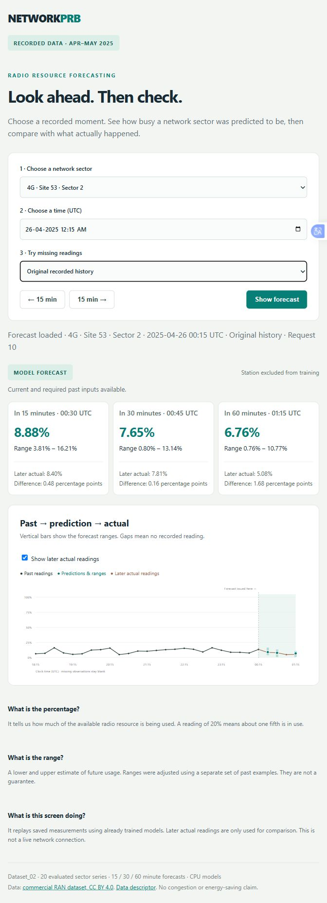
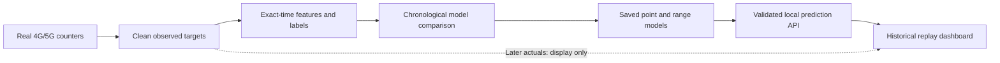

# NetworkPRB

### Reliable 4G/5G radio-resource forecasting under missing telemetry

Predict sector-level resource utilization **15, 30 and 60 minutes ahead** from real operational measurements. Compare lightweight CPU models, calibrate forecast ranges, test missing inputs, and inspect predictions through a local historical-replay dashboard.

[Quick start](#quick-start) · [Architecture](#architecture) · [Results](#results) · [Dataset](#dataset) · [Documentation](#documentation)

## Project at a glance

| Problem | Approach | Delivered |
|---|---|---|
| Forecast radio-resource usage when measurements may be missing | Exact-time historical features, chronological evaluation, CPU model comparison and calibrated quantile ranges | Reproducible experiments, saved models, strict prediction API and interactive replay dashboard |

**Stack:** Python 3.13 · scikit-learn · LightGBM · NumPy · SQLite · JavaScript/SVG · standard-library HTTP server

**Verified locally:** 41 automated tests pass; 91 saved data/artifact fingerprints checked. The saved models and data are included, so opening the demo does not require training.

## Dashboard

Select a 4G/5G sector and recorded UTC time, then click **Show forecast**. Compare the predicted usage and range with the actual reading recorded later. Optional missing-input scenarios demonstrate stale-reading fallback and abstention.

[View dashboard screenshot](docs/assets/dashboard.png) · [Screen walkthrough](docs/Dashboard_Step.md) · [API contract](docs/API_Contract.md)

<details>
<summary>Expand the dashboard preview</summary>



</details>

The dashboard runs locally after setup. It replays recorded measurements; it is not a hosted live-network service.

## Architecture



- **Data:** retain genuine nonempty utilization targets; preserve measured zeros and missing timestamps.
- **Features:** current usage, exact historical lags, recent observation summaries, missingness flags and calendar inputs.
- **Evaluation:** separate training, tuning, calibration and final-test periods; purge labels crossing partition boundaries.
- **Station holdout:** exclude Site 53 from fitting, preprocessing, model selection and calibration.
- **Serving:** rebuild causal features and reuse frozen models. Future actuals never enter the prediction request.

## Results

Mean absolute error (**MAE**) measures the average distance between predictions and actual readings, in **percentage points**; lower is better. These familiar-station final-test comparisons use matching scored rows within each technology/horizon.

| Network | Ahead | Latest-value baseline | Ridge | HistGradientBoosting | LightGBM |
|---|---:|---:|---:|---:|---:|
| 4G | 15 min | 3.653 | 3.488 | 3.428 | 3.416 |
| 4G | 30 min | 4.481 | 4.225 | 4.006 | 4.000 |
| 4G | 60 min | 5.330 | 5.002 | 4.432 | 4.467 |
| 5G | 15 min | 1.410 | 1.352 | 1.335 | 1.340 |
| 5G | 30 min | 1.740 | 1.620 | 1.563 | 1.567 |
| 5G | 60 min | 2.007 | 1.865 | 1.703 | 1.707 |

Serving choices come from **tuning-period scores**, not the table above: HGB supplies five technology/horizon groups; LightGBM supplies 5G at 60 minutes. Separate LightGBM quantile models provide the ranges.

- **4G, 60 minutes:** HGB reduces matched-row average error from Ridge's 5.002 to 4.432 percentage points. Improvement is not universal across stations or forecasts.
- **Ranges:** calibrated familiar-station test inclusion was approximately 90.7–91.7%, depending on technology/horizon, against a 90% target. Temporal dependence prevents a coverage guarantee.
- **Missing inputs:** synthetic outages degraded range reliability. A fixed policy reuses a reading up to 60 minutes old without a range; older history produces no estimate.
- **CPU cost:** median all-three-horizon prediction-worker time was 9.83 ms for 4G and 7.11 ms for 5G. Peak worker working set was 140.4 MiB; these figures exclude HTTP, disk, browser and training costs.

[Full model comparison and holdout results](outputs/lightgbm_v1/Results.md) · [Range results](outputs/intervals_v1/Results.md) · [Missing-input results](outputs/telemetry_stress_v1/Results.md) · [Reliability and compute scope](docs/Reliability_Step.md)

## Dataset

**Dataset_02** contains real commercial radio-access-network measurements: LTE 1800 MHz and NR 2100 MHz, on a 15-minute clock. The recording span is February–May 2025 with gaps; utilization is already a percentage.

This bounded experiment extracts **114,460 observed readings across 20 technology/sector series from five stations**. The original archive, clean SQLite observations and exact-time training tables are included.

[Original archive](data/raw/Dataset_02.zip) · [Extraction metadata](data/processed/manifest_v1.json) · [Dataset review](docs/Dataset_Research.md) · [Publisher record](https://doi.org/10.5281/zenodo.17815388)

## Quick start

Verified environment: **Windows x64, Python 3.13.4, CPU only**. No NVIDIA GPU is required. From a PowerShell terminal:

```powershell
git clone https://github.com/Pavan-amikula/NetworkPRB.git
cd NetworkPRB
py -3.13 -m venv --without-pip .venv
.\.venv\Scripts\python.exe -m ensurepip --upgrade
.\.venv\Scripts\python.exe -m pip install --only-binary=:all: -r requirements-ml-lock.txt
.\.venv\Scripts\python.exe -m networkprb.api --port 8765
```

Open **http://127.0.0.1:8765** in a browser. Keep the terminal running; stop with Ctrl+C. Models are loaded from the included trusted local artifacts. Other Python versions and a clean-machine installation have not been validated.

To check the included artifacts and code:

```powershell
.\.venv\Scripts\python.exe scripts\verify_project.py
.\.venv\Scripts\python.exe -m unittest discover -s tests -v
.\.venv\Scripts\python.exe -m pip check
```

[Complete setup and fresh-workspace reproduction](docs/Reproduce.md)

## Repository map

| Path | Purpose |
|---|---|
| [networkprb/](networkprb/) | Inference engine, local API, replay data separation and dashboard |
| [scripts/](scripts/) | Extraction, training, evaluation and artifact verification |
| [tests/](tests/) | Time alignment, split boundaries, missing inputs and API checks |
| [data/](data/) | Original archive, clean observations and supervised tables |
| [outputs/](outputs/) | Saved models, predictions, metrics and experiment evidence |
| [audit/](audit/) | Original raw-data audit results |
| [docs/](docs/) | Research, experiment explanations and operating instructions |

## Limitations

This is a small-cohort historical study. Counter availability at its recorded timestamp is assumed; reporting delay is unverified. The selected final-test cohort has no readings at or above 80%, so high-load warning performance is not established. No live network control, energy savings, universal unseen-station improvement or guaranteed forecast accuracy is claimed.

## Documentation

[Project overview](docs/START_HERE.md) · [Implementation status](docs/Project_Progress.md) · [Research and method comparison](docs/Methods_Comparison.md) · [API contract](docs/API_Contract.md) · [Development rules](CONTRIBUTING.md)

## Attribution and license

Dataset: Lehoczky et al., *Performance Management Counters from Live 5G, 4G and 2G Radio Access Network*, [Zenodo record](https://doi.org/10.5281/zenodo.17815388), **CC BY 4.0**. [Data descriptor](https://doi.org/10.1038/s41597-026-07723-0). This project extracts a subset and derives forecasting tables; the underlying measurements retain their attribution and license.

Original project code is available under the [MIT License](LICENSE). Dataset and third-party publication terms are separate; see [NOTICE.md](NOTICE.md).
